# IP Camera 웹 설정 매뉴얼

> 이 문서는 웹 브라우저로 **MARKIN IP 카메라**에 접속해 **라이브 영상 확인 · 영상/카메라 화질 설정 · 네트워크 설정 · 모션/AI 이벤트 설정**을 하는 방법을 설명합니다.
>
> 화면은 영어(ENGLISH) UI 기준입니다.

## 목차
{: .no_toc}

* 목차
{:toc}

---

## 1. 시작하기

### 1.1 준비 사항

| 항목 | 내용 |
| --- | --- |
| PC 브라우저 | Chrome / Edge 최신 버전 권장 (별도 플러그인 설치 불필요) |
| 네트워크 | 카메라와 PC가 같은 네트워크(대역)에 연결되어 있어야 함 |
| 카메라 IP | 기본은 **DHCP**. IP를 모를 때는 [mInstaller](../mInstaller/)로 검색 |
| 기본 계정 | ID `admin` / 비밀번호는 설치 담당자에게 확인 (최초 로그인 후 변경 권장, 6.4 참고) |

> 💡 DHCP 서버가 없는 환경에서도 카메라는 **ZEROCONF IP**(`169.254.x.x`)를 함께 가집니다. PC를 같은 `169.254.x.x` 대역으로 설정하면 이 주소로도 접속할 수 있습니다.

### 1.2 접속 및 로그인

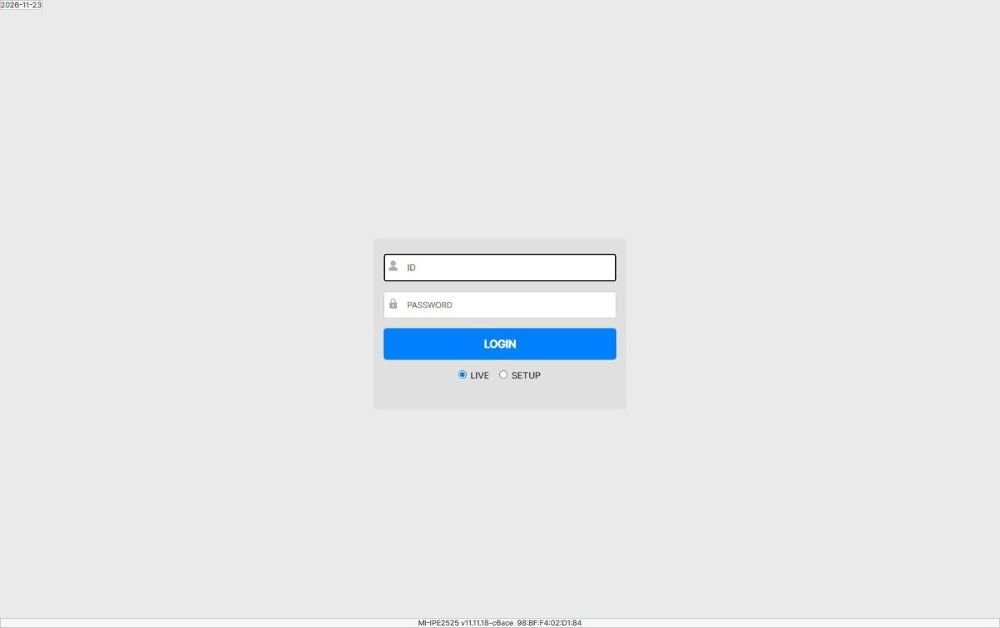

1. 브라우저 주소창에 `http://<카메라 IP>/` 를 입력합니다. (예: `http://192.168.45.59/`)
2. **ID** 와 **PASSWORD** 를 입력합니다.
3. 로그인 후 처음 열 화면을 고릅니다.
   - **LIVE** : 라이브 영상 화면 (3장)
   - **SETUP** : 설정 화면 (5장)
4. **LOGIN** 버튼을 누릅니다.

> 화면 아래쪽에는 모델명 · 펌웨어 버전 · MAC 주소가 표시됩니다.

---

## 2. 화면 구성

모든 화면 위쪽에는 같은 도구 막대가 있습니다.

| 아이콘 | 버튼 | 위치 | 기능 |
| :---: | --- | --- | --- |
|  | **Logout** | 왼쪽 위 | 로그아웃하고 로그인 화면으로 이동 |
|  | **Live** | 가운데 | 라이브 영상 화면 (3장) |
|  | **Live AI** | 가운데 | AI 라이브 화면 — 객체 박스·이벤트 확인 (4장) |
|  | **Setup** | 가운데 | 설정 화면 (5장 ~ 9장) |
| 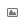 | **SNAPSHOT** | 오른쪽 위 (Live) | 현재 영상을 이미지 파일로 저장 |
|  | **FULL SCREEN** | 오른쪽 위 (Live) | 영상을 전체 화면으로 보기 |
|  | 모델명 · 버전 | 오른쪽 위 (Setup) | 현재 펌웨어 버전 표시 |

---

## 3. 라이브 화면 (LIVE)

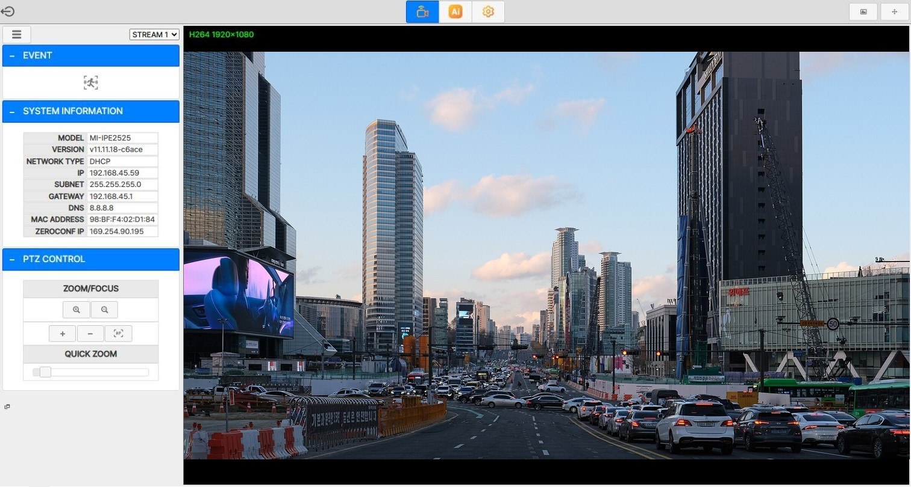

| 영역 | 설명 |
| --- | --- |
|  **메뉴** | 왼쪽 패널 숨기기 / 보이기 |
| **STREAM 선택** | 볼 스트림 선택 — `STREAM 1`(메인) / `STREAM 2`(서브) / `STREAM 3` |
| **영상 영역** | 왼쪽 위에 코덱 · 해상도 표시 (예: `H264 1920×1080`) |
| **EVENT** | 모션 이벤트 표시. 모션이 감지되면 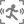 아이콘 상태가 바뀜 |
| **SYSTEM INFORMATION** | 모델, 버전, 네트워크 방식(DHCP/STATIC), IP, 서브넷, 게이트웨이, DNS, MAC, ZEROCONF IP |
| **PTZ CONTROL** | 줌 / 포커스 조작 (아래 표) |

### 3.1 PTZ CONTROL (줌 / 포커스)

| 아이콘 | 버튼 | 기능 |
| :---: | --- | --- |
|   | 줌 인 / 줌 아웃 | 화각을 좁히거나(확대) 넓힘(축소) |
|   | 포커스 + / − | 포커스 수동 조정 |
| 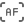 | AF | 오토 포커스 한 번 실행 |
|  | **QUICK ZOOM** | 슬라이더로 원하는 줌 위치로 바로 이동 |

> 💡 줌을 바꾼 뒤 초점이 흐리면  **AF** 버튼을 누르세요. 설정 화면의 **ZOOM/FOCUS** (7.5)에서도 같은 조작을 할 수 있습니다.

---

## 4. AI 라이브 화면 (Ai)

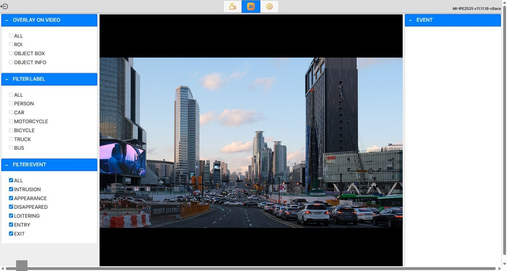

AI 객체 검출 결과를 영상 위에 겹쳐 보여 주는 화면입니다. AI 기능은 **SETUP › EVENT › AI** (9.2)에서 켜야 동작합니다.

| 영역 | 설명 |
| --- | --- |
| **OVERLAY ON VIDEO** | 영상 위에 표시할 정보 — `ROI`(감시 영역), `OBJECT BOX`(객체 박스), `OBJECT INFO`(객체 이름·신뢰도) |
| **FILTER:LABEL** | 표시할 객체 종류 — PERSON, CAR, MOTORCYCLE, BICYCLE, TRUCK, BUS |
| **FILTER:EVENT** | 오른쪽 이벤트 목록에 표시할 이벤트 — INTRUSION, APPEARANCE, DISAPPEARED, LOITERING, ENTRY, EXIT |
| **EVENT (오른쪽)** | 발생한 AI 이벤트 목록 |

---

## 5. 설정 화면 (SETUP) 사용법

설정 화면은 **왼쪽 메뉴**와 **오른쪽 설정 영역**으로 나뉩니다. 메뉴 그룹(`+ SYSTEM` 등)을 누르면 하위 메뉴가 펼쳐집니다.

| 메뉴 그룹 | 하위 메뉴 |
| --- | --- |
| **SYSTEM** | SYSTEM INFORMATION · SYSTEM MANAGEMENT · DATE & TIME · USER MANAGEMENT · LOG |
| **VIDEO** | VIDEO STREAM · VIDEO SETUP · CAMERA SETUP · PRIVACY SETUP · ZOOM/FOCUS · OSD |
| **NETWORK** | INTERFACE · PORT · UPNP · RTSP / ONVIF |
| **EVENT** | MOTION SETUP · AI |

공통 버튼

| 아이콘 | 버튼 | 기능 |
| :---: | --- | --- |
|  | 저장 (페이지 오른쪽 아래) | 현재 페이지의 설정을 카메라에 저장. **저장하지 않고 다른 메뉴로 이동하면 변경 내용이 적용되지 않습니다.** |
| 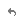 | 되돌리기 (CAMERA SETUP 각 표 아래) | 해당 표의 값을 기본값으로 되돌림 |

> ⚠️ CAMERA SETUP(7.3)에는 저장 버튼이 없고, 슬라이더·콤보를 바꾸면 바로 카메라에 적용됩니다. 나머지 메뉴는  저장을 눌러야 적용됩니다.

---

## 6. SYSTEM

### 6.1 SYSTEM INFORMATION

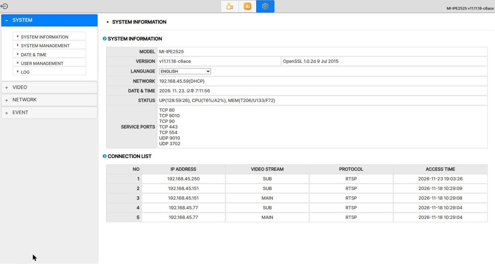

| 항목 | 설명 |
| --- | --- |
| MODEL / VERSION | 모델명, 펌웨어 버전, OpenSSL 버전 |
| LANGUAGE | 웹 화면 언어 — ENGLISH, KOREAN, JAPANESE, SIMPLIFIED CHINESE, TRADITIONAL CHINESE, GERMAN |
| NETWORK | 현재 IP 와 방식(DHCP/STATIC) |
| DATE & TIME | 카메라 현재 시각 |
| STATUS | 동작 시간(UP), CPU 사용률, 메모리(전체/사용/여유) |
| SERVICE PORTS | 현재 열려 있는 서비스 포트 목록 |
| **CONNECTION LIST** | 최근 영상 접속 기록 — 접속 IP, 스트림(MAIN/SUB), 프로토콜(RTSP 등), 접속 시각 |

### 6.2 SYSTEM MANAGEMENT

| 항목 | 설명 |
| --- | --- |
| 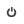 **SYSTEM REBOOT** | 카메라 재시작 |
|  **FACTORY DEFAULT** | 공장 초기화. **Keep Network Configuration** 을 체크하면 IP 등 네트워크 설정은 유지 |
| 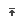 **FIRMWARE UPGRADE** | 펌웨어 파일을 선택하면 업그레이드 시작. 아래에 현재 펌웨어 버전과 NPU(AI) 버전 표시 |
|  **EXPORT** | 체크한 항목의 설정을 파일로 저장 — ALL, DATE & TIME, USER MANAGEMENT, VIDEO, EVENT, CAMERA SETUP, DAY & NIGHT, NETWORK INTERFACE, NETWORK SERVICE, EVENT AI |
|  **IMPORT** | 저장해 둔 설정 파일을 불러와 적용 |

> ⚠️ 펌웨어 업그레이드 중에는 **전원을 끄거나 브라우저를 닫지 마세요.** 완료 후 카메라가 자동으로 재시작합니다.
>
> 💡 여러 대에 같은 설정을 넣을 때는 한 대를 설정한 뒤 **EXPORT** → 다른 카메라에서 **IMPORT** 하면 편리합니다. (네트워크 설정을 옮기지 않으려면 NETWORK INTERFACE 는 체크하지 마세요.)

### 6.3 DATE & TIME

| 구역 | 항목 | 설명 |
| --- | --- | --- |
| DATE / TIME CONFIGURATION | CURRENT DATE / TIME, TIME ZONE | 현재 카메라 시각과 시간대 |
| **SET DATE / TIME** (체크해서 사용) | SYSTEM TIME | **USE CURRENT SYSTEM TIME** — 접속한 PC 시각으로 맞춤 |
| | NEW DATE / TIME | 날짜·시·분·초 직접 입력 |
| | TIME ZONE | 시간대 선택 (한국은 GMT+9 시간대) |
| | DAY LIGHT SAVING | 일광절약시간(DST) 사용 |
| DATE / TIME FORMAT | DATE FORMAT / TIME FORMAT | 영상 OSD 등에 표시되는 날짜·시간 형식 |
| TIME SYNC | TIME SYNC MODE | `NONE` 또는 `SERVER`(NTP 서버와 자동 동기화) |

### 6.4 USER MANAGEMENT

- **USER LIST** : 등록된 사용자 목록. **EDIT** 로 수정, **DELETE** 로 삭제,  **NEW** 로 새 사용자 입력 시작
- **ADD / MODIFY** : 사용자 정보 입력 후 **ADD**(추가) 또는 **MODIFY**(수정)

| 항목 | 설명 |
| --- | --- |
| USER ID | 영문+숫자 5~16자 |
| DESCRIPTION | 사용자 설명 |
| PASSWORD / CONFIRM PASSWORD | 영문 소문자·대문자·숫자·특수문자 중 **3종류 이상 조합, 9자 이상**. 공백, 반복·연속 문자는 사용할 수 없음 |
| PERMISSION | `Live`(영상 보기) / `Setup`(설정 변경) 권한 |

> 💡 보안을 위해 설치 후 `admin` 비밀번호를 반드시 변경하고, 영상만 보는 사용자에게는 `Live` 권한만 주세요.

### 6.5 LOG

카메라 동작 기록(RTSP 접속/종료, 스트림 설정 변경 등)을 시간 순서로 보여 줍니다.

- 오른쪽 위 콤보(예: `1/5`)로 페이지를 바꿉니다.
- **Log usage** 에 로그 저장 공간 사용량이 표시됩니다.
- **CLEAR** 를 누르면 로그를 모두 지웁니다.

---

## 7. VIDEO

### 7.1 VIDEO STREAM

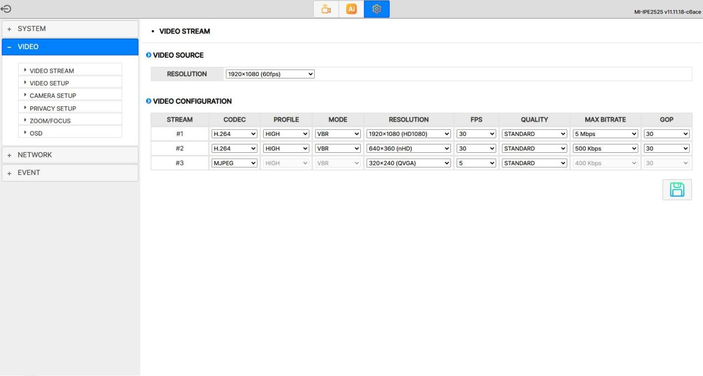

**VIDEO SOURCE › RESOLUTION** 에서 센서 출력 모드를 고릅니다 — `1920×1080 (30fps)` 또는 `1920×1080 (60fps)`.

**VIDEO CONFIGURATION** 에서 스트림 3개를 각각 설정합니다.

| 항목 | 설명 |
| --- | --- |
| STREAM | `#1` 메인 / `#2` 서브 / `#3` 세 번째 스트림 (RTSP 주소는 8.4 참고) |
| CODEC | `H.264` / `H.265` (#3은 `MJPEG`) |
| PROFILE | H.264 프로파일 — BASELINE / MAIN / HIGH |
| MODE | `VBR`(가변 비트레이트, 화질 우선) / `CBR`(고정 비트레이트, 대역폭 우선) |
| RESOLUTION | 640×360, 640×480, 800×600, 1280×720, 1920×1080 등 |
| FPS | 초당 프레임 수 (1 ~ 30, 60fps 모드에서는 최대 60) |
| QUALITY | VBR 화질 — LOW / STANDARD / HIGH / HIGHEST |
| MAX BITRATE | 최대 비트레이트 (32 Kbps ~ 수 Mbps) |
| GOP | I-프레임 간격 (보통 FPS와 같게 설정) |

> 💡 NVR 녹화용으로는 #1을 `H.265 / 1920×1080 / 30fps`, 모바일·다채널 보기용으로는 #2를 낮은 해상도로 쓰는 것을 권장합니다.

### 7.2 VIDEO SETUP

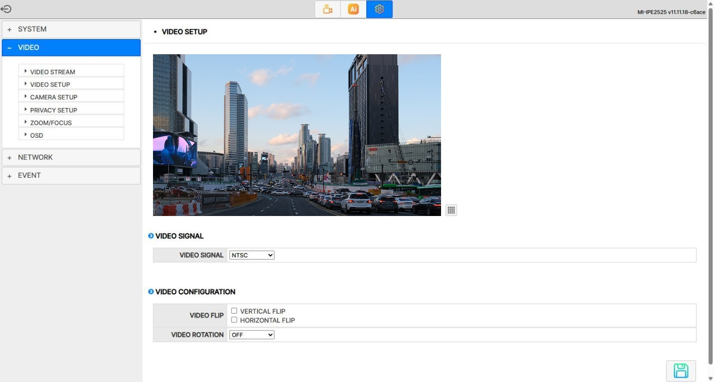

| 항목 | 설명 |
| --- | --- |
| VIDEO SIGNAL | 아날로그(CVBS) 출력 방식 — `NTSC` / `PAL` |
| VIDEO FLIP | **VERTICAL FLIP**(상하 반전), **HORIZONTAL FLIP**(좌우 반전) |
| VIDEO ROTATION | 영상 회전 — `OFF` / `90degree` / `270degree`. 복도처럼 세로로 긴 장소를 찍을 때 사용(코리더 모드) |

> 영상 오른쪽 아래  버튼을 누르면 미리보기 위에 격자를 표시해 화각·수평 맞추기를 도와줍니다.

### 7.3 CAMERA SETUP

위쪽 미리보기로 결과를 보면서 화질을 조정합니다. 값은 바꾸는 즉시 영상에 반영됩니다. 아래쪽 **CAMERA CONFIGURATION** 은 5개 탭으로 나뉩니다.

#### EXPOSURE (노출)

| 항목 | 설명 |
| --- | --- |
| BRIGHTNESS | 목표 밝기 |
| IRIS MODE | `ELC`(전자 셔터로 밝기 제어) / `ALC`(DC-IRIS 렌즈 조리개로 제어) |
| SHUTTER | `AUTO`(범위 안에서 자동) / `MANUAL`(고정) / `FLICKER`(형광등 깜빡임 방지). 오른쪽 콤보로 셔터 속도 범위 지정 (1/30 ~ 1/30000) |
| DSS | 저속 셔터 — `OFF` / `x2` / `x4`. 어두운 곳에서 밝아지지만 움직임 잔상이 생길 수 있음 |
| AGC | 최대 게인(증폭). 높을수록 어두운 곳이 밝지만 노이즈 증가 |
| ANTI-SATURATION | 밝은 부분 포화(번짐) 억제 |
| CONTROL SPEED | IRIS / SHUTTER / AGC 가 바뀌는 속도 |

#### COLOR (색상)

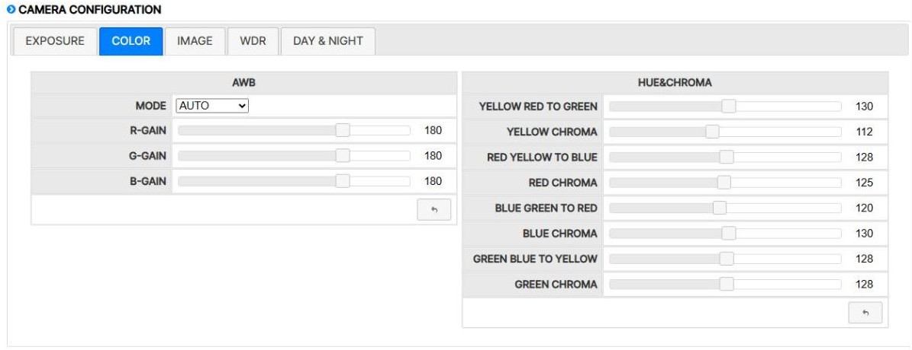

| 항목 | 설명 |
| --- | --- |
| AWB MODE | 화이트밸런스 — `AUTO` / `AUTOext`(넓은 색온도 범위 자동) / `MANUAL`(R/G/B-GAIN 직접 조정) |
| R-GAIN / G-GAIN / B-GAIN | 수동 화이트밸런스 색 게인 |
| HUE & CHROMA | 색 영역별 색조(… TO …)와 채도(… CHROMA) 미세 조정 |

#### IMAGE (영상 개선 / 노이즈)

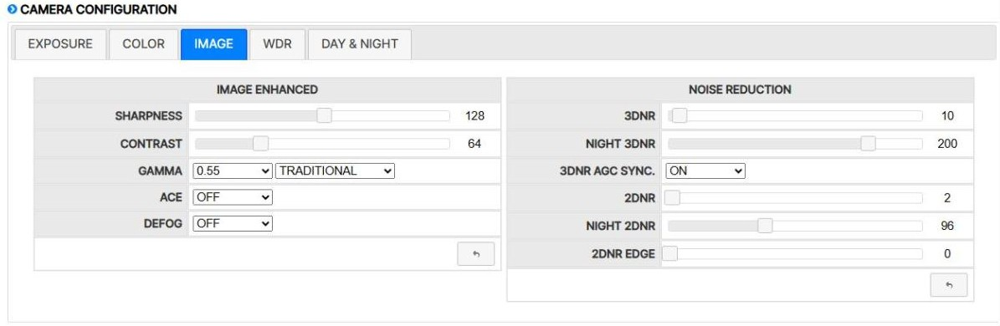

| 항목 | 설명 |
| --- | --- |
| SHARPNESS | 선명도 |
| CONTRAST | 대비 |
| GAMMA | 감마 값(0.40 ~ 0.75)과 방식(`LOW SAT.` / `TRADITIONAL`) |
| ACE | 어두운 부분 밝기 보정 — OFF / LOW / MIDDLE / HIGH |
| DEFOG | 안개·연무 보정 — OFF / LOW / MIDDLE / HIGH |
| 3DNR / NIGHT 3DNR | 시간축 노이즈 제거 (주간 / 야간) |
| 3DNR AGC SYNC. | 게인에 맞춰 3DNR 강도 자동 조절 |
| 2DNR / NIGHT 2DNR / 2DNR EDGE | 공간축 노이즈 제거 (주간 / 야간 / 경계 보존) |

#### WDR (광역 역광 보정)

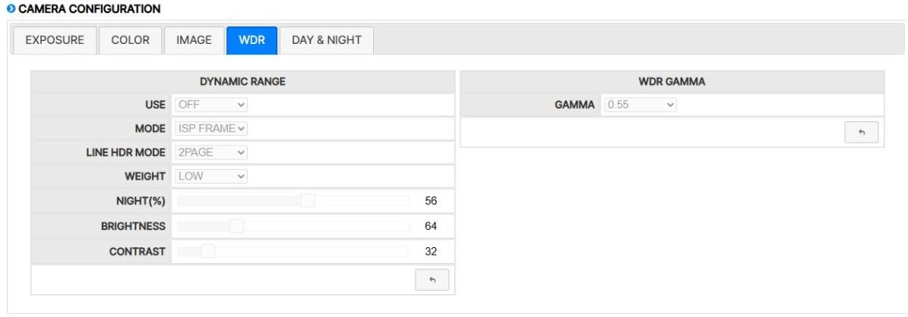

| 항목 | 설명 |
| --- | --- |
| USE | WDR 사용 여부. 켜면 아래 항목이 활성화됨 |
| MODE | `ISP FRAME` / `LINE HDR` |
| LINE HDR MODE | `2PAGE` / `3PAGE` |
| WEIGHT | 보정 강도 — LOW / MIDDLE / HIGH |
| NIGHT(%) / BRIGHTNESS / CONTRAST | 야간 적용 비율, WDR 밝기·대비 |
| WDR GAMMA | WDR 사용 시 감마 |

> 💡 창문·출입구처럼 밝은 곳과 어두운 곳이 함께 보이는 장소에서 WDR 을 켜세요.

#### DAY & NIGHT (주야간 전환)

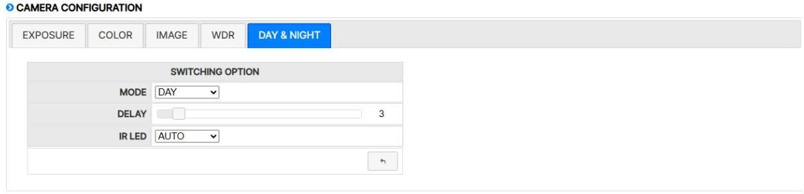

| 항목 | 설명 |
| --- | --- |
| MODE | `AUTO`(밝기에 따라 자동) / `DAY`(항상 컬러) / `NIGHT`(항상 흑백) / `EXT_ADC`·`EXT(LOW)`·`EXT(HIGH)`(외부 조도 센서 신호로 전환) / `SCHEDULE`(시간대 지정) |
| DELAY | 주야간 전환 지연 시간 (잦은 전환 방지) |
| IR LED | 적외선 LED — `AUTO`(야간에 자동 점등) / `ON` / `OFF` |

### 7.4 PRIVACY SETUP

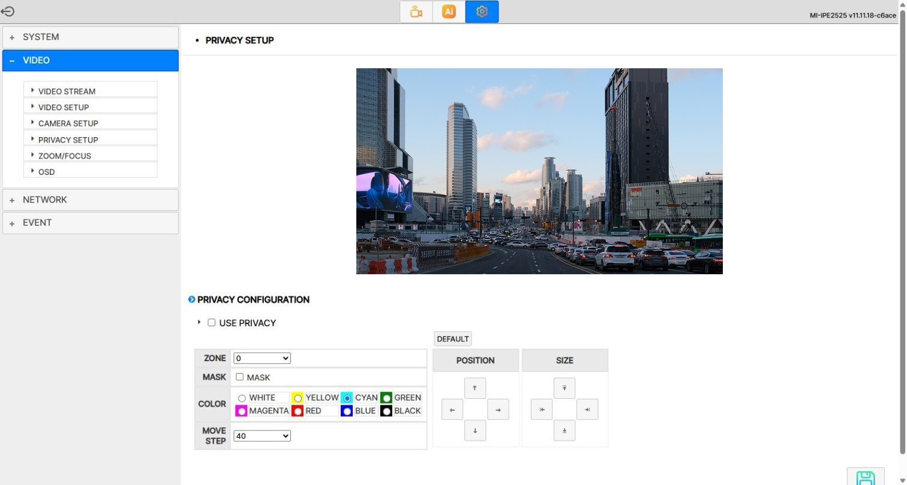

영상의 일부를 가려(마스킹) 보이지 않게 합니다.

1. **USE PRIVACY** 를 체크합니다.
2. **ZONE** 에서 영역 번호(0 ~ 3, 최대 4개)를 고르고 **MASK** 를 체크합니다.
3. **COLOR** 에서 가림 색을 고릅니다 (WHITE, YELLOW, CYAN, GREEN, MAGENTA, RED, BLUE, BLACK).
4. **POSITION** 버튼(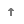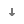)으로 위치를, **SIZE** 버튼(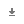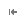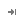)으로 크기를 조정합니다. **MOVE STEP**(40 ~ 400)은 버튼 한 번에 움직이는 양입니다.
5.  저장합니다. **DEFAULT** 를 누르면 영역 위치·크기를 기본값으로 되돌립니다.

### 7.5 ZOOM/FOCUS

| 항목 | 설명 |
| --- | --- |
| MODEL | 장착된 렌즈 모델 (예: `2M_AF2812Y`) |
| ZOOM | 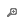 줌 인 / 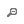 줌 아웃, **LENS INITIALIZATION**(렌즈 위치 초기화) |
| FOCUS |  /  포커스 수동 조정, **AUTO FOCUS**(오토 포커스 실행) |
| OPTIONS | **AF on Day/Night Switch** — 주야간 전환 시 자동으로 AF 실행 (IR 전환 후 초점 틀어짐 방지) |
| | **Use PTZ control lock** — 줌/포커스 조작 잠금 |

> 💡 설치 후 화각을 맞출 때: 줌으로 화각 조정 → **AUTO FOCUS** → 필요하면 FOCUS +/− 로 미세 조정.

### 7.6 OSD

영상 위에 제목과 날짜·시간 글자를 표시합니다.

| 항목 | 설명 |
| --- | --- |
| DISPLAY | 표시할 내용 — `OFF` / `TITLE` / `DATE TIME` / `TITLE+DATE TIME` |
| TITLE | 표시할 제목 글자와 색(WHITE / BLACK / RED / BLUE / GREEN) |
| DATE TIME | 날짜·시간 표시 색 (형식은 6.3 DATE / TIME FORMAT 을 따름) |
| FONT SIZE | 글자 크기 |

미리보기의 **주황 박스(제목)** 와 **파란 박스(날짜·시간)** 를 마우스로 끌어 표시 위치를 옮길 수 있습니다.

---

## 8. NETWORK

### 8.1 INTERFACE

| 항목 | 설명 |
| --- | --- |
| NETWORK TYPE | `DHCP`(자동 IP) / `STATIC`(고정 IP). STATIC 이면 아래 항목을 직접 입력 |
| IP ADDRESS / SUBNET MASK / GATEWAY / DNS | 네트워크 주소 |
| MAC ADDRESS | 카메라 고유 MAC 주소 (변경 불가) |
| NETWORK SPEED | 랜 속도 (예: `10/100Base-TX` 자동 협상) |
| ZEROCONF IP | 체크 시 `169.254.x.x` 링크 로컬 주소를 함께 사용 |

> ⚠️ IP 를 바꾸고 저장하면 접속이 끊깁니다. 새 IP 로 다시 접속하세요. IP 를 잊었으면 [mInstaller](../mInstaller/)로 검색합니다.

### 8.2 PORT

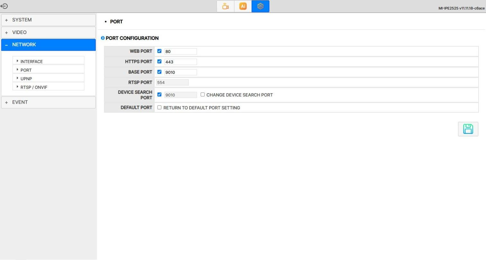

| 항목 | 기본값 | 설명 |
| --- | --- | --- |
| WEB PORT | 80 | 웹(HTTP) 접속 포트 |
| HTTPS PORT | 443 | 보안 웹(HTTPS) 접속 포트 |
| BASE PORT | 9010 | 전용 프로그램(NVR/VMS) 연동 포트 |
| RTSP PORT | 554 | RTSP 영상 포트 (RTSP / ONVIF 메뉴에서 변경) |
| DEVICE SEARCH PORT | 9010 | mInstaller 장치 검색 포트. **CHANGE DEVICE SEARCH PORT** 체크 후 변경 |
| DEFAULT PORT | — | **RETURN TO DEFAULT PORT SETTING** 체크 후 저장하면 모든 포트를 기본값으로 |

> 포트 왼쪽 체크박스를 해제하면 해당 서비스를 사용하지 않습니다.

### 8.3 UPNP

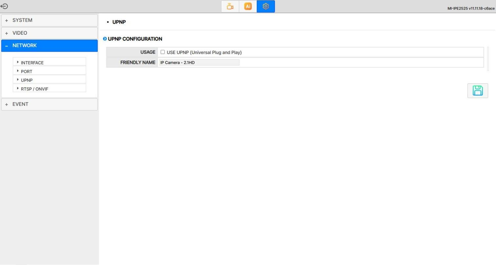

| 항목 | 설명 |
| --- | --- |
| USAGE | **USE UPNP** — 윈도우 네트워크 탐색기에 카메라가 표시되도록 함 |
| FRIENDLY NAME | 탐색기에 표시될 이름 |

### 8.4 RTSP / ONVIF

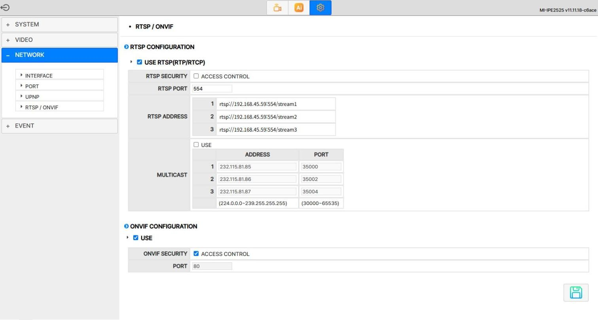

**RTSP CONFIGURATION**

| 항목 | 설명 |
| --- | --- |
| USE RTSP(RTP/RTCP) | RTSP 스트리밍 사용 |
| RTSP SECURITY | **ACCESS CONTROL** 체크 시 RTSP 접속에 ID/비밀번호 필요 |
| RTSP PORT | 기본 554 |
| RTSP ADDRESS | 스트림별 주소 — `rtsp://<IP>:554/stream1` (#1), `stream2` (#2), `stream3` (#3) |
| MULTICAST | **USE** 체크 시 스트림별 멀티캐스트 주소(224.0.0.0 ~ 239.255.255.255)·포트(30000 ~ 65535) 사용 |

**ONVIF CONFIGURATION**

| 항목 | 설명 |
| --- | --- |
| USE | ONVIF 사용 (NVR/VMS 자동 등록) |
| ONVIF SECURITY | **ACCESS CONTROL** 체크 시 ONVIF 인증 사용 |
| PORT | ONVIF 포트 (웹 포트와 같음, 기본 80) |

> 💡 VLC 에서 보기: **미디어 › 네트워크 스트림 열기** 에 `rtsp://<IP>:554/stream1` 입력. ACCESS CONTROL 을 켰다면 `rtsp://<ID>:<비밀번호>@<IP>:554/stream1` 형식으로 입력합니다.

---

## 9. EVENT

### 9.1 MOTION SETUP

**MOTION AREA** — 영상을 격자로 나눠 모션을 감지할 영역을 지정합니다. 빨간 칸이 감지 영역입니다.

-  마우스를 **왼쪽 위 → 오른쪽 아래** 로 끌면 영역 **선택**
-  마우스를 **오른쪽 아래 → 왼쪽 위** 로 끌면 영역 **해제**

**MOTION CONFIGURATION**

| 항목 | 설명 |
| --- | --- |
| POST-ALARM | 모션이 멈춘 뒤 이벤트 상태를 유지하는 시간 (예: 5 SEC) |
| MOTION SENSITIVITY | 감도 (높을수록 작은 움직임도 감지) |

> 모션이 감지되면 라이브 화면 EVENT 패널(3장)에 표시되고, ONVIF 이벤트로 NVR 에 전달됩니다.

### 9.2 AI

AI(NPU) 기반 객체 검출과 영상 분석(침입·배회 등)을 설정합니다. 위쪽 미리보기에서 검출 결과와 ROI 를 확인할 수 있습니다.

#### OBJECT DETECTION (객체 검출)

| 항목 | 설명 |
| --- | --- |
| USE OBJECT DETECTION | 객체 검출 사용 |
| MODEL | AI 모델 — `OBJECTS`(사람·차량 등) / `FACE`(얼굴) |
| LABEL | 객체별 표시 색(COLOR), 검출 기준값(THRESHOLD, 높을수록 확실한 것만), 크기 범위(WIDTH / HEIGHT 최소~최대) |
| NPU SPEED | AI 처리 속도 (1 ~ 7) |
| USE OSD | 검출 결과를 영상에 직접 표시 — SHAPE(`BOX`/`MASK`), COLOR, MASK PATTERN, TRANSPARENCY |
| USE SNAPSHOT | AI 이벤트 스냅샷 기능 사용 |

> 💡 **USE OSD** 의 `MASK` 를 쓰면 검출된 사람·차량을 가려서 내보낼 수 있습니다 (개인정보 보호용).

#### VIDEO ANALYTICS (영상 분석)

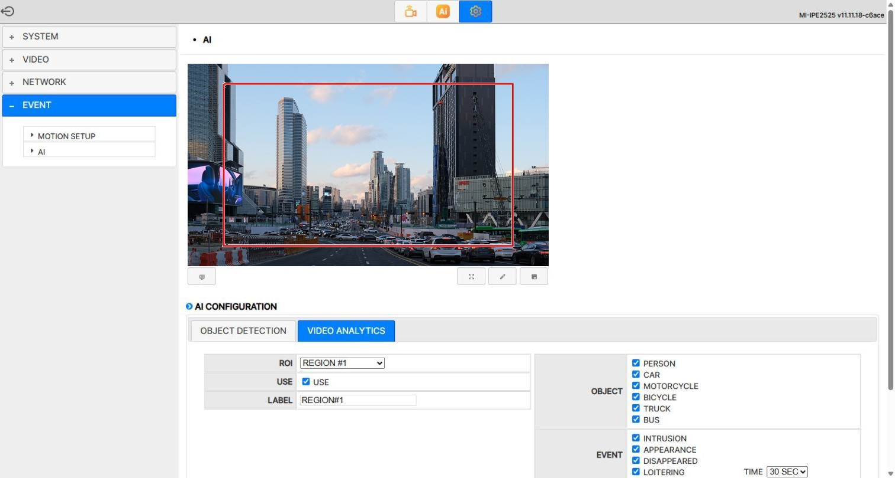

미리보기에 선택한 ROI(빨간 선)가 표시됩니다. 미리보기 아래 버튼으로 ROI 를 편집합니다.

| 아이콘 | 버튼 | 기능 |
| :---: | --- | --- |
|  | 이벤트 로그 | AI 이벤트 로그 창을 새 창으로 열기 (미리보기 왼쪽 아래) |
|  | ALL | ROI 를 영상 전체로 지정 |
|  | EDIT | 미리보기에서 ROI 를 그리거나 수정 |
| 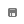 | SAVE | 그린 ROI 저장 |

| 항목 | 설명 |
| --- | --- |
| ROI | 설정할 영역 — `REGION #1~#4`(다각형 영역) / `LINE #1~#4`(통과선) |
| USE / LABEL | 영역 사용 여부와 이름 |
| OBJECT | 감시할 객체 — PERSON, CAR, MOTORCYCLE, BICYCLE, TRUCK, BUS |
| EVENT | `INTRUSION`(영역 침입), `APPEARANCE`(나타남), `DISAPPEARED`(사라짐), `LOITERING`(배회, TIME 이상 머무름). LINE 은 ENTRY / EXIT(통과 방향) |
| LINKUP | **TO MOTION DETECTION** — AI 이벤트를 모션 이벤트로도 전달 (모션만 지원하는 NVR 연동용), **ALARM OUT** — 알람 출력 연동(알람 출력 단자가 있는 경우) |

---

## 10. 문제 해결

| 증상 | 확인 사항 |
| --- | --- |
| 웹 접속이 안 됨 | PC 와 카메라가 같은 대역인지 확인. [mInstaller](../mInstaller/)로 IP 를 검색하거나 ZEROCONF IP(`169.254.x.x`)로 접속 |
| 로그인이 안 됨 | ID/비밀번호 확인. 계속 실패하면 공장 초기화가 필요할 수 있음 (설치 업체 문의) |
| 영상이 안 나옴 | 다른 STREAM 선택, 브라우저 새로고침. VIDEO STREAM(7.1)의 코덱·해상도 확인 |
| 초점이 흐림 | ZOOM/FOCUS(7.5)에서 **AUTO FOCUS**. 주야간 전환 후 흐려지면 **AF on Day/Night Switch** 사용 |
| 밤에 영상이 너무 어둡거나 노이즈가 많음 | DAY & NIGHT(7.3) MODE·IR LED 확인, EXPOSURE 의 AGC·DSS, IMAGE 의 NIGHT 3DNR 조정 |
| NVR 에 등록이 안 됨 | RTSP / ONVIF(8.4)에서 ONVIF **USE** 확인, ACCESS CONTROL 사용 시 NVR 에 같은 계정 입력 |
| 설정을 바꿨는데 적용이 안 됨 | 페이지 오른쪽 아래  저장을 눌렀는지 확인 |

---

## 부록 A. 용어 설명

### A.1 영상 압축 · 스트림

| 용어 | 설명 | 관련 메뉴 |
| --- | --- | --- |
| **해상도 (Resolution)** | 영상을 이루는 가로×세로 화소 수. 1920×1080(Full HD, 약 200만 화소), 1280×720(HD), 640×360(nHD) 등. 클수록 세밀하지만 데이터량이 늘어남 | 7.1 |
| **FPS (Frames Per Second)** | 1초에 보내는 영상 장수. 30fps면 움직임이 자연스럽고, 낮추면 끊겨 보이는 대신 데이터량이 줄어듦 | 7.1 |
| **코덱 (Codec)** | 영상을 압축·복원하는 방식. 카메라는 압축된 영상을 네트워크로 보냄 | 7.1 |
| **H.264 (AVC)** | 가장 널리 쓰이는 영상 압축 방식. 대부분의 NVR·PC·스마트폰에서 재생 가능 | 7.1 |
| **H.265 (HEVC)** | H.264보다 압축률이 높아 같은 화질에서 데이터량이 약 30~50% 적음. 재생 장치가 H.265를 지원해야 함 | 7.1 |
| **MJPEG** | 프레임마다 JPEG 사진으로 보내는 방식. 처리가 단순하지만 데이터량이 큼. 저해상도·저프레임 보조 스트림에 사용 | 7.1 |
| **프로파일 (Profile)** | H.264의 압축 기능 수준. BASELINE < MAIN < HIGH 순으로 압축 효율이 높음. 오래된 재생 장치는 BASELINE만 지원할 수 있음 | 7.1 |
| **비트레이트 (Bitrate)** | 초당 전송 데이터량(Kbps, Mbps). 높을수록 화질이 좋지만 네트워크·저장 용량을 많이 사용 | 7.1 |
| **CBR (Constant Bitrate)** | 고정 비트레이트. 장면과 관계없이 일정한 데이터량으로 보내므로 대역폭 계산이 쉬움. 움직임이 많으면 화질이 떨어질 수 있음 | 7.1 |
| **VBR (Variable Bitrate)** | 가변 비트레이트. 장면이 복잡하면 데이터를 늘리고 단순하면 줄여 화질을 일정하게 유지. 최대값은 MAX BITRATE로 제한 | 7.1 |
| **GOP (Group of Pictures)** | I-프레임(완전한 한 장) 사이의 간격. GOP=30, 30fps면 1초마다 I-프레임. 작을수록 화면 깨짐 복구·탐색이 빠르지만 데이터량이 늘어남 | 7.1 |
| **I-프레임 / P-프레임** | I-프레임은 한 장 전체를 담은 기준 프레임, P-프레임은 앞 프레임과 달라진 부분만 담은 프레임 | 7.1 |
| **메인 / 서브 스트림** | 한 카메라가 동시에 보내는 여러 영상. 메인(#1)은 고화질 녹화용, 서브(#2·#3)는 다채널 보기·모바일용 저화질 | 3, 7.1 |
| **RTSP** | 영상 스트림을 주고받는 표준 프로토콜. VLC·NVR에서 `rtsp://<IP>:554/stream1` 형식으로 접속 | 8.4 |
| **멀티캐스트 (Multicast)** | 한 번 보낸 영상을 여러 수신 장치가 함께 받는 방식. 시청 장치가 많을 때 카메라·네트워크 부하를 줄임 | 8.4 |
| **ONVIF** | IP 카메라와 NVR/VMS 간 호환을 위한 국제 표준. 제조사가 달라도 자동 검색·영상·이벤트 연동 가능 | 8.4 |
| **NTSC / PAL** | 아날로그 영상 출력 방식. 한국·미국·일본은 NTSC, 유럽 등은 PAL | 7.2 |

### A.2 노출 · 밝기

| 용어 | 설명 | 관련 메뉴 |
| --- | --- | --- |
| **노출 (Exposure)** | 센서가 받는 빛의 양. 셔터·조리개·게인으로 조절 | 7.3 EXPOSURE |
| **셔터 속도 (Shutter)** | 센서가 빛을 받는 시간. 1/30초처럼 길면 밝지만 움직이는 물체가 번지고, 1/1000초처럼 짧으면 선명하지만 어두워짐 | 7.3 EXPOSURE |
| **아이리스 (Iris, 조리개)** | 렌즈로 들어오는 빛의 양을 조절하는 구멍 | 7.3 EXPOSURE |
| **ELC (Electronic Light Control)** | 렌즈 조리개 대신 전자 셔터로 밝기를 조절하는 방식 | 7.3 EXPOSURE |
| **ALC / DC-IRIS** | 렌즈의 자동 조리개(DC-IRIS)를 열고 닫아 밝기를 조절하는 방식. 밝은 실외에서 유리 | 7.3 EXPOSURE |
| **AGC (Automatic Gain Control)** | 어두울 때 영상 신호를 전자적으로 증폭하는 기능. 값이 높으면 밝아지지만 노이즈(자글거림)도 커짐 | 7.3 EXPOSURE |
| **DSS (Digital Slow Shutter)** | 매우 어두울 때 셔터를 프레임 간격보다 길게(x2, x4) 열어 밝게 만드는 기능. 움직이는 물체에 잔상이 생김 | 7.3 EXPOSURE |
| **플리커 (Flicker)** | 형광등 등 조명의 깜빡임 주기와 셔터가 어긋나 화면 밝기가 줄무늬처럼 떨리는 현상. SHUTTER를 `FLICKER`로 하면 줄어듦 | 7.3 EXPOSURE |
| **포화 (Saturation)** | 빛이 너무 강해 밝은 부분이 하얗게 날아가는 현상. ANTI-SATURATION으로 억제 | 7.3 EXPOSURE |
| **역광** | 피사체 뒤쪽이 밝아(창문·출입구) 피사체가 어둡게 찍히는 상황 | 7.3 WDR |
| **WDR (Wide Dynamic Range)** | 밝은 곳과 어두운 곳이 함께 있는 장면에서 양쪽을 모두 잘 보이게 하는 기능 | 7.3 WDR |
| **다이나믹 레인지 (Dynamic Range)** | 한 화면에서 표현할 수 있는 가장 어두운 곳과 가장 밝은 곳의 범위 | 7.3 WDR |
| **Line HDR** | 노출이 다른 여러 장(2장/3장)을 센서에서 찍어 합성하는 WDR 방식. 효과가 크지만 움직임이 빠르면 겹쳐 보일 수 있음 | 7.3 WDR |

### A.3 색상 · 화질

| 용어 | 설명 | 관련 메뉴 |
| --- | --- | --- |
| **화이트밸런스 (AWB)** | 조명 색(백열등의 노란빛, 그늘의 푸른빛 등)과 관계없이 흰색이 흰색으로 보이도록 색을 보정하는 기능 | 7.3 COLOR |
| **색온도 (K, 켈빈)** | 빛의 색을 숫자로 나타낸 것. 3000K는 노란빛(백열등), 5000K는 주광, 8000K는 푸른빛 | 7.3 COLOR |
| **R / G / B 게인** | 빨강·초록·파랑 성분의 세기. 수동 화이트밸런스에서 직접 조정 | 7.3 COLOR |
| **색조 (Hue)** | 색의 종류(빨강·노랑·파랑 등). HUE & CHROMA에서 특정 색 영역을 다른 색 쪽으로 약간 이동 | 7.3 COLOR |
| **채도 (Chroma, Saturation)** | 색의 진하기. 높으면 선명하고 낮으면 흑백에 가까움 | 7.3 COLOR |
| **선명도 (Sharpness)** | 경계(윤곽)를 강조하는 정도. 너무 높으면 윤곽에 흰 테두리·노이즈가 생김 | 7.3 IMAGE |
| **대비 (Contrast)** | 밝은 곳과 어두운 곳의 차이. 높으면 또렷하지만 어두운 부분이 뭉개질 수 있음 | 7.3 IMAGE |
| **감마 (Gamma)** | 중간 밝기를 표현하는 곡선. 값을 낮추면 어두운 부분이 밝아 보이고, 높이면 진하고 대비가 강해 보임 | 7.3 IMAGE |
| **ACE (Adaptive Contrast Enhancement)** | 어두운 부분의 밝기를 자동으로 끌어올려 디테일을 살리는 기능 | 7.3 IMAGE |
| **디포그 (Defog)** | 안개·연무·먼지로 뿌옇게 보이는 영상의 대비를 높여 또렷하게 하는 기능 | 7.3 IMAGE |
| **노이즈 (Noise)** | 어두운 환경에서 화면에 생기는 자글자글한 점. AGC가 높을수록 커짐 | 7.3 IMAGE |
| **2DNR (2D Noise Reduction)** | 한 장 안에서 주변 화소를 비교해 노이즈를 줄이는 기능. 강하면 디테일이 흐려짐 | 7.3 IMAGE |
| **3DNR (3D Noise Reduction)** | 앞뒤 프레임을 비교해 노이즈를 줄이는 기능. 정지 영역에 효과가 크고, 강하면 움직이는 물체에 잔상이 생김. 노이즈가 줄면 비트레이트도 줄어듦 | 7.3 IMAGE |

### A.4 주야간 · 렌즈

| 용어 | 설명 | 관련 메뉴 |
| --- | --- | --- |
| **Day & Night (TDN)** | 밝을 때는 컬러, 어두울 때는 흑백으로 바꿔 야간 감도를 높이는 기능. 전환 시 IR 차단 필터가 움직임 | 7.3 DAY & NIGHT |
| **IR LED (적외선 LED)** | 사람 눈에 보이지 않는 적외선 조명. 야간 흑백 모드에서 어두운 곳을 비춤 | 7.3 DAY & NIGHT |
| **조도 센서 (CDS / ADC)** | 주변 밝기를 측정하는 센서. EXT 계열 모드는 이 센서 값으로 주야간을 전환 | 7.3 DAY & NIGHT |
| **전환 지연 (Delay)** | 밝기가 기준을 넘은 뒤 실제로 전환하기까지 기다리는 시간. 차량 전조등 등에 의해 자주 바뀌는 것을 막음 | 7.3 DAY & NIGHT |
| **줌 (Zoom)** | 렌즈 배율을 바꿔 화각을 좁히거나(확대) 넓히는 기능. 이 카메라는 전동 줌 렌즈를 사용 | 3.1, 7.5 |
| **AF (Auto Focus)** | 영상의 선명도를 분석해 자동으로 초점을 맞추는 기능 | 3.1, 7.5 |
| **화각 (FOV)** | 카메라가 담는 범위(각도). 줌 인하면 좁아지고 멀리 있는 물체가 크게 보임 | 7.5 |
| **프라이버시 마스크** | 영상 일부를 단색 사각형으로 가려 녹화·전송되지 않게 하는 기능 | 7.4 |
| **OSD (On Screen Display)** | 영상 위에 겹쳐 표시하는 글자(제목, 날짜·시간 등) | 7.6 |

### A.5 이벤트 · AI

| 용어 | 설명 | 관련 메뉴 |
| --- | --- | --- |
| **모션 감지 (Motion Detection)** | 지정 영역에서 화면 변화(움직임)를 감지해 이벤트를 발생시키는 기능 | 9.1 |
| **감도 (Sensitivity)** | 이벤트를 일으키는 변화의 기준. 높으면 작은 움직임에도 반응하지만 오감지(나뭇잎·빛 변화)가 늘어남 | 9.1 |
| **Post-Alarm** | 움직임이 멈춘 뒤에도 이벤트 상태를 유지하는 시간 | 9.1 |
| **NPU (Neural Processing Unit)** | AI 연산 전용 프로세서. 카메라 안에서 사람·차량 검출을 처리 | 9.2 |
| **객체 검출 (Object Detection)** | 영상에서 사람·차량 등 물체를 찾아 종류와 위치(박스)를 알아내는 기능 | 4, 9.2 |
| **Threshold (신뢰도 기준)** | AI가 판단한 확신 정도가 이 값 이상일 때만 검출로 인정. 높이면 오검출이 줄고 놓치는 경우가 늘어남 | 9.2 |
| **ROI (Region of Interest)** | 분석할 관심 영역. 이 안에서만 이벤트를 판단 | 4, 9.2 |
| **침입 / 배회 (Intrusion / Loitering)** | 침입은 객체가 ROI 안에 들어온 경우, 배회는 정해진 시간 이상 머무른 경우 | 9.2 |

---

영상 예시 이미지: “Teheran-ro Yeongdong-daero crossing 2” by kallerna, [CC BY-SA 4.0](https://creativecommons.org/licenses/by-sa/4.0/), via [Wikimedia Commons](https://commons.wikimedia.org/wiki/File:Teheran-ro_Yeongdong-daero_crossing_2.jpg). 매뉴얼 스크린샷의 영상 영역에 합성되었습니다.
