# mInstaller 사용자 매뉴얼

> **mInstaller (MARKIN IP Installer)** 는 같은 네트워크에 연결된 IP 카메라를 자동으로 검색하고, 네트워크 설정 · 펌웨어 업그레이드 · 유지보수 · 영상 확인을 한 화면에서 처리하는 Windows용 설치 도구입니다.

## 목차
{: .no_toc}

* 목차
{:toc}

---

## 1. 시작하기

### 1.1 설치 및 실행

1. 배포된 `mInstaller-vX.X.exe` 설치 파일을 실행해 설치합니다.
2. 바탕화면 또는 시작 메뉴에서 **mInstaller**를 실행합니다.
3. 프로그램은 한 번에 하나만 실행됩니다. 이미 실행 중이면 "프로그램이 이미 실행 중입니다." 메시지가 표시됩니다.

### 1.2 준비 사항

| 항목 | 내용 |
| --- | --- |
| 운영체제 | Windows 10 / 11 |
| 네트워크 | 카메라와 같은 스위치(대역)에 PC 연결 |
| 방화벽 | 장치 검색 포트(UDP)가 막혀 있지 않아야 함 |
| VLC (선택) | 목록의 **VLC** 버튼으로 영상을 볼 때 필요 — `C:\Program Files\VideoLAN\VLC` 에 설치 |

---

## 2. 화면 구성

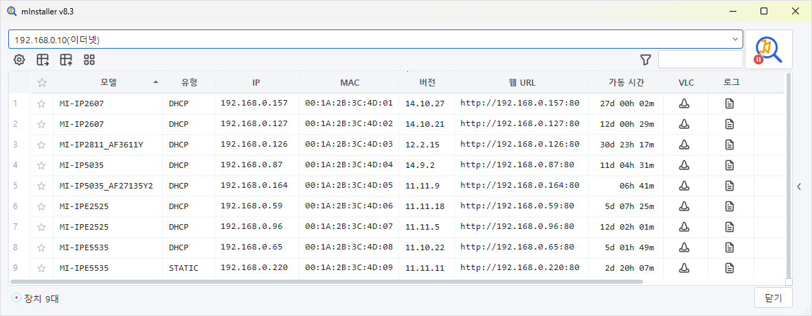

| 영역 | 설명 |
| --- | --- |
| **상단 도구 영역** | 네트워크 카드(NIC) 선택, 도구 버튼(아래 2.1), 필터, 검색 시작/중지 |
| **장치 목록** | 검색된 카메라 표시. 선택한 장치에 설정이 적용됨 |
| **오른쪽 패널** | 계정 입력, **네트워크 / 유지보수** 탭, 미리보기. 목록 오른쪽 끝의 `‹ / ›` 버튼으로 열고 닫음 |
| **하단 상태 표시줄** | 장치 수, 필터 결과, 다른 대역/응답 없음 장치 수, 작업 진행 상태 |

### 2.1 상단 도구 버튼

| 아이콘 | 버튼 | 기능 |
| :---: | --- | --- |
|  | **프로그램 정보** | 버전 확인, 검색 포트·VLC 캐싱·언어·미리보기 설정 (13장) |
|  | **장치 목록 내보내기** | 목록을 CSV 파일로 저장 (6.1) |
|  | **장치 목록 가져오기** | CSV 파일로 네트워크 설정 일괄 적용 (6.1) |
| 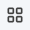 | **RTSP 뷰어** | 선택한 장치를 다채널 뷰어로 보기 (11장) |
|  | **어안 모드** | 어안 지원 모델만 선택했을 때 나타남 (부록 B) |
|  | **필터** | 오른쪽 입력란에 입력한 글자가 포함된 장치만 표시 (3.5) |
|  | **검색 시작 / 중지** | 누를 때마다 검색을 시작하거나 멈춤. 검색 중에는 빨간 일시정지 표시가 나타남 (3.1) |

---

## 3. 장치 검색

### 3.1 검색 시작 / 중지

1. 상단 콤보에서 카메라가 연결된 **네트워크 카드(NIC)** 를 선택합니다.
2. 오른쪽 위 **검색** 버튼을 누르면 검색이 시작되고, 다시 누르면 중지됩니다. (프로그램을 실행하면 자동으로 검색을 시작합니다.)
3. 단축키 **F5** 로도 검색을 다시 시작할 수 있습니다.

> 💡 검색을 시작할 때마다 PC의 네트워크 정보(IP 변경, 랜 재연결 등)를 다시 읽어옵니다.

### 3.2 장치 목록 항목

| 열 | 설명 |
| --- | --- |
| ★ (북마크) | 자주 쓰는 장치 고정. 3.4 참고 |
| 모델 | 카메라 모델명 |
| 유형 | 네트워크 방식 (STATIC / DHCP) |
| IP | 카메라 IP 주소 |
| MAC | 카메라 MAC 주소 |
| 버전 | 펌웨어 버전 |
| 웹 URL | 카메라 웹 페이지 주소 |
| 가동 시간 | 카메라가 켜진 후 경과 시간 |
| VLC | VLC로 RTSP 영상 열기 |
| 로그 | 카메라 로그 조회 창 열기 |

### 3.3 목록 사용 팁

- **셀 클릭** → 해당 값이 클립보드에 복사됩니다. (MAC은 `:` 없이 복사) "복사됨: …" 툴팁이 잠시 표시됩니다.
- **웹 URL 더블클릭** → 기본 웹 브라우저로 카메라 웹 페이지를 엽니다.
- **열 머리글 클릭** → 해당 열 기준으로 정렬합니다.
- **IP에 "PC와 다른 대역입니다" 툴팁이 뜨는 장치** → PC와 다른 대역의 장치입니다. 접속하려면 장치 IP를 PC 대역으로 변경해야 합니다.
- **응답 없음** 표시 → 검색 중 응답이 끊긴 장치이며, 마지막 응답 시각이 함께 표시됩니다.

### 3.4 북마크

- 행의 ★ 를 체크하면 해당 장치가 북마크됩니다.
- 북마크한 장치는 프로그램을 다시 시작해도 **응답이 없어도 목록에 항상 표시**되어, 꺼져 있거나 연결이 끊긴 장치를 쉽게 확인할 수 있습니다.
- ★ **열 머리글**을 클릭하면 현재 목록의 장치를 모두 북마크하거나 모두 해제합니다.

### 3.5 필터

상단 **필터** 입력란에 글자를 입력하면 모델, IP, MAC, 버전 등에 해당 글자가 포함된 장치만 표시됩니다. (대소문자 구분 없음)
상태 표시줄에 `장치 N대 (필터 M대)` 형식으로 결과 수가 표시됩니다.

---

## 4. 계정 입력

오른쪽 패널 상단의 **사용자 ID / 비밀번호**에 카메라 관리자 계정을 입력합니다.
네트워크 설정, 유지보수, 업그레이드, 설정 내보내기, 영상 보기 등 대부분의 기능이 이 계정으로 카메라에 로그인합니다.

> ⚠️ 계정이 맞지 않는 장치가 섞여 있으면 적용 전에 "계정 정보가 맞지 않는 장치가 있습니다. 계속하시겠습니까?" 확인 창이 표시됩니다.

---

## 5. 미리보기

장치를 선택하면 오른쪽 패널 아래쪽에 미리보기가 표시됩니다.

- 표시 방식은 **프로그램 정보 → 미리보기** 에서 `스냅샷` 또는 `동영상 (RTSP)` 중 선택합니다.
- 동영상 재생 중 왼쪽 위 **캠코더 아이콘을 더블클릭**하면 해당 장치를 다채널 뷰어로 크게 엽니다.
- 연결할 수 없거나 이미지가 없으면 "미리보기를 표시할 수 없습니다" 메시지가 나타납니다.

---

## 6. 네트워크 설정 (네트워크 탭)

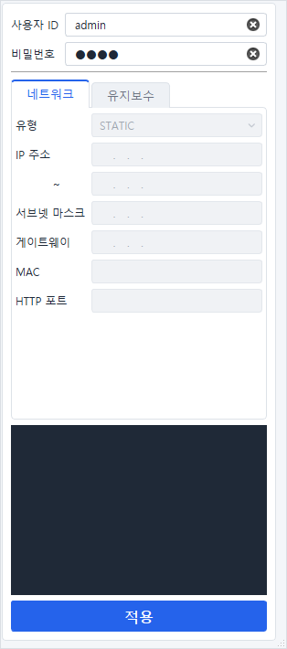

1. 목록에서 설정할 장치를 선택합니다.
2. **네트워크** 탭에서 값을 입력합니다.
3. **적용**을 누르고 확인 창에서 **확인**을 선택합니다.

| 항목 | 설명 |
| --- | --- |
| 유형 | `STATIC`(고정 IP) / `DHCP`(자동) |
| IP 주소 | 고정 IP. **여러 대 선택 시** `시작 IP ~ 끝 IP` 범위를 입력하면 순서대로 할당 |
| 서브넷 마스크 | 예: 255.255.255.0 |
| 게이트웨이 | 예: 192.168.1.1 |
| HTTP 포트 | 카메라 웹 포트 |

> ⚠️ IP/서브넷/게이트웨이 형식이 잘못되면 적용되지 않고 오류 메시지가 표시됩니다.

### 6.1 장치 목록 내보내기 / 가져오기 (CSV)

**내보내기**
- **장치 목록 내보내기** 버튼 → `devicelist_YYYYMMDDTHHMMSS.csv` 로 저장됩니다.
- 필터가 입력되어 있으면 필터에 맞는 장치만 저장됩니다.
- 열 구성: `No, Model, Type, IP, Subnet, Gateway, MAC, Version, HTTP Port, TCP Port`

**가져오기 (일괄 네트워크 설정)**
1. 내보낸 CSV 파일을 엑셀 등에서 열어 **Type / IP / Subnet / Gateway** 값을 원하는 대로 수정합니다.
2. **장치 목록 가져오기** 버튼으로 파일을 선택합니다.
3. 파일의 **MAC 주소와 일치하는 장치**에 해당 네트워크 설정이 일괄 적용되고, 적용 결과 목록이 표시됩니다.

> ⚠️ Type은 `STATIC` 또는 `DHCP`, MAC은 `00:11:22:33:44:55` 형식이어야 합니다. 형식이 맞지 않는 줄은 무시됩니다.

---

## 7. 유지보수 (유지보수 탭)

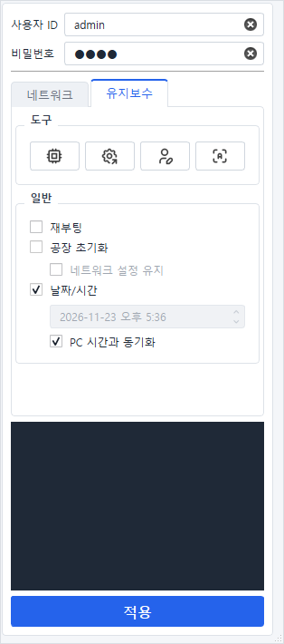

선택한 장치에 아래 작업을 적용합니다. **일반**에서 원하는 항목을 체크한 뒤 **적용**을 누릅니다.

- **재부팅**: 장치를 재시작
- **공장 초기화**: 모든 설정을 초기값으로 되돌림
  - **네트워크 설정 유지**: 공장 초기화 시 IP 등 네트워크 설정은 유지
- **날짜/시간**: 장치 시간을 설정. **PC 시간과 동기화** 체크 시 PC 시각으로 맞춤

### 7.1 도구 버튼

**도구** 영역의 버튼은 선택한 장치에 바로 실행됩니다. (왼쪽부터)

| 아이콘 | 버튼 | 기능 |
| :---: | --- | --- |
|  | **업그레이드** | 펌웨어 / 설정 파일 업그레이드 (8장) |
|  | **설정 내보내기** | 장치 설정을 XML로 저장 (10장) |
|  | **계정 변경** | 장치 관리자 계정 변경 (9장) |
|  | **MFZ 초기화** | 장치의 MFZ를 초기화 |

**MFZ 초기화** 버튼을 누르면 아래 확인 창이 나타납니다. **확인**을 눌러야 실행되고, **취소**를 누르면 아무 작업도 하지 않습니다.

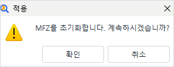

---

## 8. 펌웨어 업그레이드

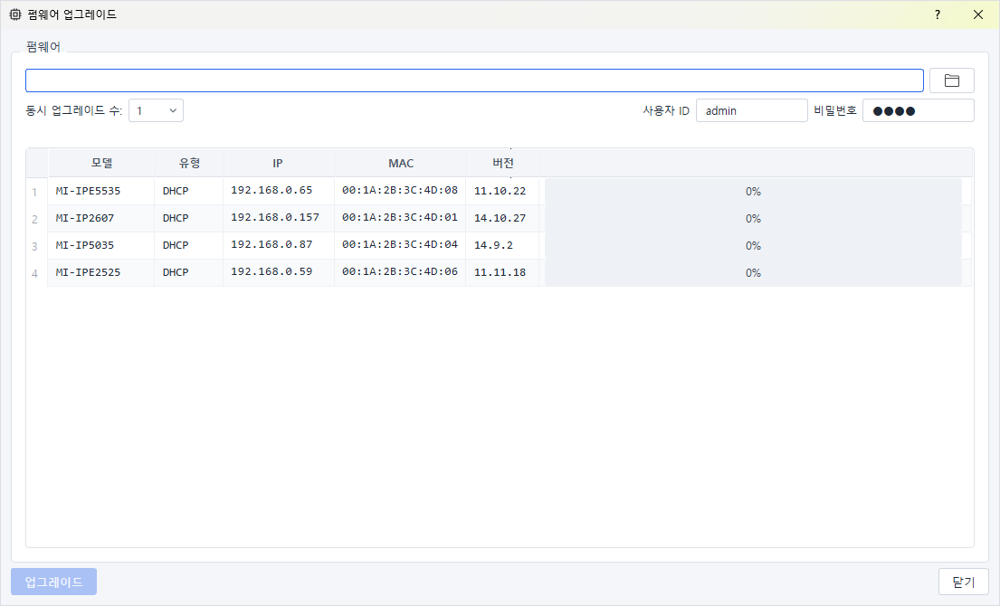

1. 업그레이드할 장치를 선택하고 **업그레이드** 버튼을 누릅니다.
2. **펌웨어** 항목에서 파일을 선택합니다.
   - `*.bin` : 펌웨어 파일
   - `*.xml` : 내보낸 설정 파일 또는 OEM 설정 파일 (설정 업데이트)
3. **동시 업그레이드 수**를 지정합니다. (여러 대를 동시에 진행)
4. **업그레이드**를 누르면 장치별로 진행률과 결과가 표시됩니다. (로그인 → 모델 확인 → 파일 전송 → `완료! 재부팅 중`)
5. 실패한 장치는 **재시도**로 다시 진행할 수 있습니다.

> 💡 로그인 실패로 중단된 경우, 창에서 사용자 ID/비밀번호를 다시 입력하고 **업그레이드**를 누르면 이어서 진행합니다.
> ⚠️ 업그레이드 중에는 장치 전원을 끄거나 네트워크를 분리하지 마세요.

---

## 9. 계정 변경

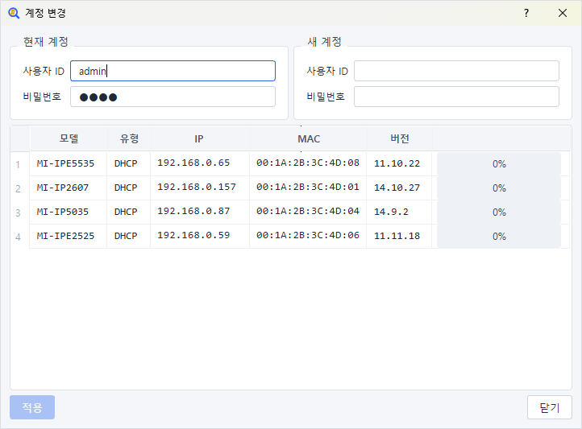

1. 장치를 선택하고 **계정 변경**을 누릅니다.
2. **현재 계정**과 **새 계정**(사용자 ID / 비밀번호)을 입력합니다.
3. **적용** → 확인 후 장치별 결과가 표시됩니다.

---

## 10. 설정 내보내기 (Setup Export)

장치 한 대의 설정을 XML 파일로 저장합니다. 저장한 파일은 업그레이드 창에서 다른 장치에 적용할 수 있습니다.

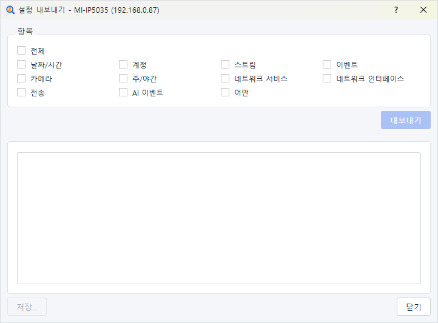

1. 장치를 **한 대만** 선택하고 **설정 내보내기**를 누릅니다.
2. 내보낼 항목을 체크합니다. (전체, 카메라, 주/야간, 스트림, 날짜/시간, 계정, 네트워크 인터페이스, 네트워크 서비스, 전송, 이벤트, AI 이벤트, 어안)
3. **내보내기** → **저장...** 으로 XML 파일을 저장합니다.

---

## 11. 다채널 RTSP 뷰어

선택한 여러 장치의 영상을 한 창에서 동시에 봅니다.

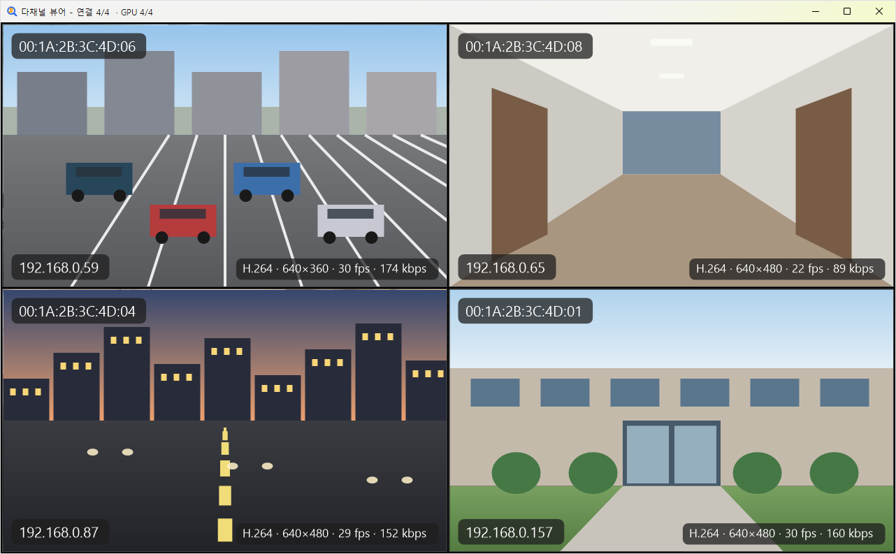

1. 장치를 선택하고 상단 도구 영역의 **RTSP 뷰어** 버튼을 누릅니다.
2. 장치 수에 맞춰 자동으로 바둑판(예: 4대 → 2×2) 배치됩니다.
3. 창 제목에 `연결 N/M` 으로 연결 상태가 표시됩니다.

**화면 우클릭 메뉴**

| 메뉴 | 설명 |
| --- | --- |
| 스냅샷 저장 (PNG) | 현재 화면을 이미지로 저장 |
| 동영상 저장 시작 (MP4) / 중지 | 영상 녹화 |
| Main stream / Sub stream | 스트림 전환 |
| 비트레이트 그래프 보기 | 그래프 패널 표시 (**Ctrl+B**) |

**비트레이트 그래프**: 스트림 선택, 집계 단위(1프레임 / 1·2·5·10초)를 바꿔 가며 비트레이트 변화를 확인할 수 있습니다.

> ℹ️ 동시에 여는 채널이 많아 PC 부하가 높으면 **자동 절전** 모드로 전환되어 10fps → 5fps → 키프레임만 표시 순으로 낮아집니다. (창 제목에 표시)

### 11.1 VLC로 보기

목록의 **VLC** 버튼을 누르면 설치된 VLC 플레이어로 `rtsp://<IP>/stream1` 영상을 엽니다. VLC가 없으면 다운로드 링크가 안내됩니다.

---

## 12. 로그 보기

목록의 **로그** 버튼을 누르면 해당 장치의 로그를 조회하는 창이 열립니다. **지우기**로 화면을 비울 수 있습니다.

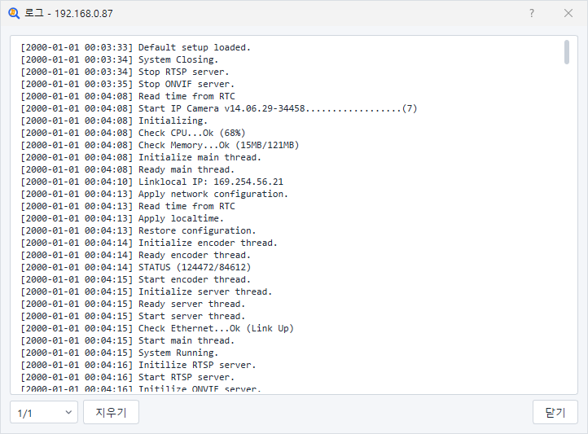

---

## 13. 프로그램 정보 / 환경 설정

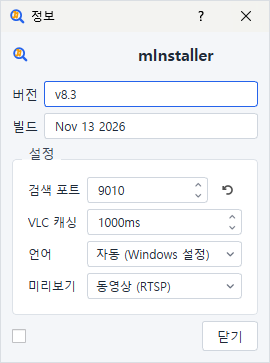

상단 도구 영역의 **프로그램 정보** 버튼으로 버전·빌드 정보와 아래 설정을 확인/변경합니다.

| 항목 | 설명 |
| --- | --- |
| 검색 포트 | 장치 검색에 사용할 포트 (↺ 버튼으로 기본값 복원) |
| VLC 캐싱 | VLC 재생 시 네트워크 버퍼(ms). 끊기면 값을 늘림 |
| 언어 | 자동 (Windows 설정) / 한국어 / English — **재시작 후 적용** |
| 미리보기 | 스냅샷 / 동영상 (RTSP) |

---

## 14. 문제 해결 (FAQ)

| 증상 | 확인 사항 |
| --- | --- |
| 장치가 검색되지 않음 | NIC 선택 확인, 방화벽 해제, 검색 포트 확인 |
| "PC와 다른 대역입니다" | 네트워크 탭에서 장치 IP를 PC와 같은 대역으로 변경 |
| "계정 정보를 확인하세요" | 오른쪽 패널의 사용자 ID/비밀번호 확인 |
| VLC 버튼이 동작하지 않음 | VLC를 기본 경로(`C:\Program Files\VideoLAN\VLC`)에 설치 |
| 영상이 끊김 | 프로그램 정보에서 VLC 캐싱 값 증가, 뷰어에서 Sub stream 사용 |
| 업그레이드 실패 | 파일 형식(.bin/.xml)과 모델 일치 여부 확인 후 **재시도** |
| 언어가 바뀌지 않음 | 프로그램 재시작 |

---

## 부록 A. 단축키

| 키 | 기능 |
| --- | --- |
| F5 | 장치 검색 다시 시작 |
| Ctrl + B | (다채널 뷰어) 비트레이트 그래프 보기/숨기기 |

---

## 부록 B. 어안 모드 변경

어안(Fisheye) 카메라의 출력 모드를 일괄 변경합니다. 아래는 **TWF-1201** 을 예로 든 절차입니다.

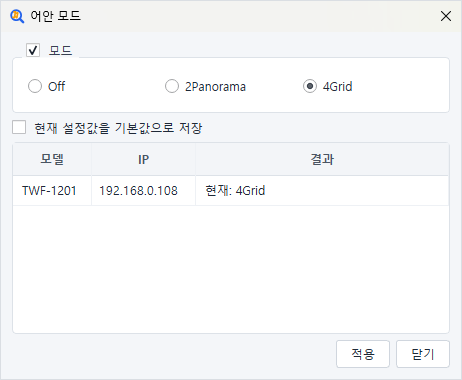

1. 목록에서 TWF-1201 을 선택합니다. 어안 지원 모델만 선택되어 있으면 상단 도구 영역에 **어안 모드** 버튼이 나타납니다.
2. 오른쪽 패널에 TWF-1201 의 **사용자 ID / 비밀번호**를 입력합니다.
3. **어안 모드** 버튼을 누르면 장치의 **현재 모드**가 조회되어 표시됩니다. (예: `현재: 4Grid`)
4. 원하는 모드(Off / 2Panorama / 4Grid)를 선택하고 **적용**을 누릅니다.
5. TWF-1201 은 모드 적용 후 **재부팅**되며, 결과 열에 적용 결과가 표시됩니다.

**지원 모델**

| 모델 그룹 | 선택 가능 모드 | 비고 |
| --- | --- | --- |
| MI-IP12912F, TWF-1201, SPK-SmartPark-S1 | Off / 2Panorama / 4Grid | 적용 후 재부팅 |
| MI-IPE12312, SPK-SmartPark-S2, SPK-SmartPark-S2x | Off / Panorama / Quad | 즉시 적용 |

- **모드** 체크를 해제하면 모드는 바꾸지 않고 기본값 저장만 할 수 있습니다.
- **현재 설정값을 기본값으로 저장**을 체크하면 선택한 모드를 장치의 기본값으로 함께 저장합니다.
- 두 그룹의 모델을 함께 선택하면 버튼 이름이 `2Panorama / Panorama` 처럼 함께 표시되고, 장치마다 맞는 값으로 전송됩니다.

